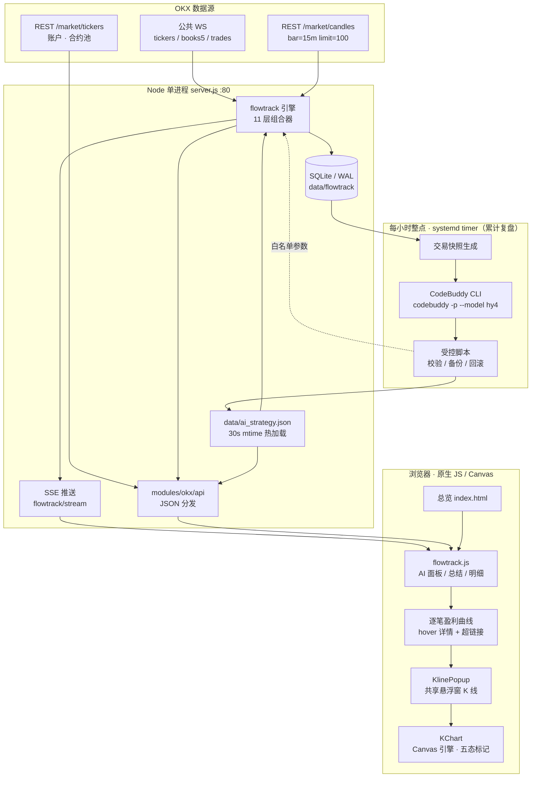

<div align="center">

# oqt-quant-node

**OKX 全市场实时监控 · 马丁格尔金字塔模拟交易 · AI 策略分析**

> 纯 Node.js（零框架 · 原生 `node:http` + `node:sqlite`）+ 原生 JavaScript / Canvas 前端。
> 单进程常驻、后台静默运行、数据自 2026-11-01 起永久保留。


</div>

---

## 目录

| | |
|---|---|
| [1. 系统概览](#1-系统概览) | [2. 整体架构](#2-整体架构) |
| [3. 交易策略（第五版）](#3-交易策略第五版) | [4. 运行时刻与调度](#4-运行时刻与调度) |
| [5. 数据保留与标的过滤](#5-数据保留与标的过滤) | [6. 前端总览面板](#6-前端总览面板) |
| [7. API 一览](#7-api-一览) | [8. AI 策略面板与每日自动分析](#8-ai-策略面板与每日自动分析) |
| [9. 代码结构（分层）](#9-代码结构分层) | [10. 部署与验证](#10-部署与验证) |
| [11. 关键配置](#11-关键配置) | [12. 运维须知](#12-运维须知) |
| [13. 版本记录](#13-版本记录) | |

---

## 1. 系统概览

系统由三条互相独立的链路组成，共享同一个 Node 进程与同一份 SQLite 数据：

| 链路 | 职责 | 数据源 | 存储 |
|---|---|---|---|
| **实时行情 / 账户** | 全市场报价、K 线、账户净值与持仓 | OKX 公共 WS + REST | `data/okx/` |
| **金字塔模拟交易** | MACD 入场 → 加仓 → 止盈，逐笔事件与盈利曲线 | `books5` / `trades` WS + `candles` REST | `data/flowtrack/flowtrack.sqlite` |
| **AI 策略分析** | 每日零点复盘、结论回写、白名单参数热加载 | 交易库快照 + Hy4 模型 | `data/ai_strategy.json` |

**当前生效的交易规则一句话版**：`只做 15m`、`每笔 0.1 USD`、`MACD(12,26,60) 零轴翻转入场`、`满 1 小时 + 浮亏 > 1% + 当前 15m MACD 柱方向同向加仓`、`浮盈 > 10% 止盈`、`同根 K 线只允许一次买卖/加仓`、`无限资金 · 不止损 · 不爆仓 · 不按时间平仓`。

> 这是**模拟盘**：所有成交按盘口吃单价在本地撮合，不下达真实订单、不调用交易 API。

---

## 2. 整体架构



**关键设计**

- **零框架**：`server.js` 用原生 `node:http` 分发；SQLite 用 Node 22 内置 `node:sqlite`，无外部数据库。
- **单一事件源**：金字塔四类事件 `buy / sell / add / close` 全部写 `pyr` 表，总结、明细、未平仓状态、K 线标记、盈利曲线都由它派生，口径天然一致。
- **双端分层组合器**：后端 `engines/flowtrack.js` 是 892 B 入口，把 `flowtrack.layers/*.js`（11 层）拼进同一执行作用域；前端 `web/js/ui/flowtrack.js` 是 1.2 KB 入口，用 `fetch` + `new Function` 把 `flowtrack_ui.layers/*.js`（10 层）拼进同一函数作用域。两端语义一致：共享作用域、业务代码逐行等价、每个文件都远小于 50 KB。
- **SSE 而非轮询**：引擎落库/结算后主动推一帧，浏览器零轮询；另有 10 秒兜底心跳刷新运行时长、WS 状态等活数据。

---

## 3. 交易策略（第五版）

### 3.1 入场信号 — `MACD(12, 26, 60)` 零轴翻转

```
DIF  = EMA(close, 12) - EMA(close, 26)
DEA  = EMA(DIF, 60)
hist = (DIF - DEA) * 2
```

| 方向 | 判定条件 |
|---|---|
| **买多** | 当前 `hist > 0`，且往前**连续 ≥ 20 根** `hist < 0` |
| **卖空** | 当前 `hist < 0`，且往前**连续 ≥ 20 根** `hist > 0` |
| 其余 | 不交易 |

- 每次取 OKX REST 最近 **100 根 15m** 收盘价（`data[0]` 为最新/进行中那根，需 reverse 成正序取 `[4]`）。
- 信号缓存带 `barTs`，只在其所在那根 K 线内有效；跨 K 线的旧信号一律作废，不会延迟消费。
- 与前端副图 `ind-engine.js` 口径完全一致。

### 3.2 资金与仓位

| 项 | 规则 |
|---|---|
| 开仓金额 | 买多 / 卖空 **每笔 0.1 USD**（`ENTRY_USD`） |
| 加仓金额 | **每笔 0.1 USD**（`ADD_USD`），不按仓位比例 |
| 总资金 | 无限，无爆仓线、无强平、无止损 |
| 数量 | `qty = 0.1 / entryPx`；开仓用吃单价（多 `ask1` / 空 `bid1`） |
| 均价 | `avg = totalCost / totalQty` |
| 毛浮盈 | `grossUnreal = dir * (px - avg) * totalQty` |
| 手续费 | 往返合计 `10 bp`（`FEE_BP`），平仓用反向吃单价 |
| 精度 | 金额 6 位小数，数量 8 位小数 |

### 3.3 加仓

四个条件**同时满足**即加仓 0.1 USD：

1. 距**开仓或上次加仓**满 `1 小时`；
2. 整仓**浮亏 > 总投入的 1%**（多空对称，按毛浮亏计）；
3. 当前 15m **MACD 柱方向与持仓同向**（买多仓柱 >0 / 卖空仓柱 <0）；
4. 当前「合约 · 周期 · K 线」事件槽未被占用。

> 加仓标签区分 **买多加仓 / 卖空加仓**。`1 小时` 间隔是沿用第五版的护栏，本次只调整阈值与信号条件，未取消间隔。

### 3.4 平仓

- **唯一平仓条件**：整仓浮盈 > 总投入的 **10%** → 止盈平仓。
- 不准止损、不准按持有时间平仓、不准分批平仓；未达标就一直持有并继续按规则加仓。

### 3.5 硬性约束

> **同一合约 · 同一周期 · 同一根 K 线，只允许一次「买多 / 卖空 / 加仓」。**

`pyrBarUsed` 以 `inst|tf|barStart` 为键做事件槽；服务重启后从 `pyr` 表回填最近 26 小时，保证重启不会绕过该规则。

### 3.6 主循环伪码

```text
每 5 秒 scan():
  for 每个未平仓金字塔 p:
      unreal = dir * (mid - avg) * qty
      if unreal > cost * 10%            -> close（止盈，记录 close 事件）
      else if -unreal > cost * 1%
              and now - sinceTs >= 1h
              and MACD信号方向 == p.dir
              and K线事件槽空闲        -> add 0.1 USD（记录 add 事件）

  for 每个 MACD 翻转信号 s:
      if 该合约已有同向持仓          -> skip
      if K线事件槽已占用             -> skip
      否则                            -> buy / sell 0.1 USD（记录事件）
```

---

## 4. 运行时刻与调度

| 任务 | 频率 | 触发点 |
|---|---|---|
| MACD 全市场刷新 | **每 15 分钟** | 严格对齐 K 线边界 `:00 / :15 / :30 / :45`（延迟 1.5 s 等 OKX 生成新 K 线） |
| 边界检查 | 每秒 | `macdSchedTick()` 只判断是否到期，不做请求 |
| REST 限速 | 5 并发 / 批，批间 400 ms | 约 12.5 req/s，低于 OKX 限流；单请求 8 s 超时 |
| 策略主循环 | 每 5 秒 | `scan()` |
| 批量落库 / 深度轮询 | 5 s / 10 s | `flush()` / `pollDeep()` |
| 结算 | 每 30 分钟 | `settle()` |
| SSE 心跳 | 每 10 秒 | `broadcast()` |
| WAL checkpoint | 每 30 分钟 | `PRAGMA wal_checkpoint(TRUNCATE)` |
| AI 策略热加载 | 每 30 秒 | 检查 `ai_strategy.json` 的 mtime |

> **不做 4 分钟全市场轮转**，也不再做旧 1H 大跃迁诊断 REST 轮询（该链路已整体删除）。

---

## 5. 数据保留与标的过滤

### 永久保留

- 起点：`2026-11-01T00:00:00+08:00`（`KEEP_FROM_TS`）。
- `KEEP_FOREVER = true`：**没有任何 `DELETE` / `VACUUM` 定时器**，引擎不删任何数据；起点只是展示标记。
- 每 30 分钟一次 `wal_checkpoint(TRUNCATE)` 仅回收 WAL 文件体积，不丢数据。

### 稳定币合约永久排除

用户长期规则：base 为法币锚定稳定币的合约一律排除（`USDC / USDT / DAI / FDUSD / TUSD / BUSD / USDE / USDG / PYUSD / EURC / USDP / USDD / FRAX / LUSD / GUSD / SUSD / USDB / CRVUSD / RLUSD / XUSD / USDX / EURT / AEUR / EURR / USDS` …），并对单根收益标准差 < 5 bp 的零波动标的做兜底剔除。

过滤落在**源头**而不只是展示层：

- `04-ws.js` 的 `loadUniverse()` 在构建采集池时就按 `STABLE_BASES` 剔除，MACD 刷新队列自然也不含这些标的；
- `07-pyramid.js` 开仓前再校验一次 `isStableInst()`；
- `06-orderflow.js` 的 `isZeroVolInst()` 做兜底：近 20 个分钟价格桶的收益标准差 < 5bp 即剔除（样本不足时放行，避免启动时误杀）；
- `10-query.js` 的所有列表/统计 SQL 仍带 `STABLE_EXCL`，保证历史数据即便混入也不会显示。

> 原因：价格恒定 ≈ 1 的合约会产生大量 `ret = 0` 平局，把胜率/回测结论整体带偏。不重新引入。
> 注意 `STABLE-USDT-SWAP` 是正常波动币种（报价约 0.029、24h 振幅 >10%），**不在**排除名单内。

---

## 6. 前端总览面板

入口 `/web/index.html`，构建戳 `window.__BUILD = '20261110f'`，旧页面检测到版本变化会自动强刷一次（`sessionStorage` 防循环）。

| 区块 | 内容 |
|---|---|
| **AI 策略面板（最顶部）** | 思维导图、一步一步分析、数据明细、迷你曲线、结论、代码改进建议、锁定项与生效参数 |
| **策略描述 / 总结卡片** | 总模拟盈利、仓位 USD、持有 USD、亏损 USD、胜率、运行时长（4~6 位小数适配 0.1 USD） |
| **逐笔盈利曲线** | Canvas 自绘视口；滚轮以**光标所在点**为圆心缩放、可左右拖动、右侧留白；hover 显示时间 / 合约 / 方向 / 本笔净盈利 / 累计净 USD / 止盈目标价 / 实际平仓价 / 均价；浮层固定右上角可交互，**合约名是超链接** |
| **事件明细表** | 15 行/页、最新在前；周期 + 事件（买多/卖空/买多加仓/卖空加仓/平仓）选项卡筛选，后端筛选后再分页 |
| **共享 K 线悬浮窗** | 明细表 / 曲线浮层点击合约名 → `KlinePopup.open(inst, {tf:'15m'})` + `LeadK.select(inst)`，与总览 K 线共用 `KChart` |
| **五态 K 线标记** | 买多 / 卖空 / 买多加仓 / 卖空加仓 / 平仓；字号缩小一倍、虚线、锚定成交价、同根同类合并 `×N` 并错开 lane；默认常显 |

> 涨跌配色遵循 A 股习惯：**涨红跌绿**。

---

## 7. API 一览

所有端点挂在 `/api/okx/<ep>` 下，由 `modules/okx/api/index.js` 分发，返回 JSON。

### 金字塔模拟交易

| 端点 | 参数 | 说明 |
|---|---|---|
| `flowtrack` | — | 总结面板 + 曲线 + WS/调度诊断（`stats()`） |
| `pyr_summary` | — | 总结面板核心数字 |
| `pyr_all` | `page, sort, order, tf, ev` | 全部事件分页（15 行/页，后端筛选） |
| `pyr_positions` | `page, tf, ev` | 未平仓持仓分页（实时估值；前端面板已移除，接口保留供诊断/外部调用） |
| `pyr_insts` | `limit` | 按事件数排序的合约榜 |
| `pyr_trades` | `inst, page, marks` | 某合约事件；`marks=1` 返回全部供 K 线叠加 |
| `pyr_marks` | `inst, tf` | K 线叠加标记 |
| `ai_strategy` | — | AI 报告 + 已生效参数 + 锁定项 + 拒绝项 |
| `flowtrack/stream` | — | SSE 长连接，实时推送统计帧 |

### 兼容路由（委托到金字塔数据，避免旧前端断链）

`flowtrack_jumphist`、`flowtrack_jm2insts`、`flowtrack_jm2trades`。

### 行情 / 账户 / 工具

`instruments`、`tickers`、`book`、`positions`、`kline`、`pull`、`backfill`、`account`、`pnl`、`trades`、`status`、`cred`（凭证仅接受 POST，不出现在 URL / access log）。

---

## 8. AI 策略面板与每日自动分析

### 8.1 数据契约

`data/ai_strategy.json` 由服务器每小时整点回写（累计复盘）：

```json
{
  "generatedAtBj": "2026-11-10 00:00:03 (北京时间)",
  "verdict": "**样本不足**：0 笔平仓，胜率不可评估",
  "highlights": [
    {"level":"danger","text":"**0 平仓样本**，不得解读为零风险"},
    {"level":"warn","text":"浮亏 1% 阈值低，需观察加仓频率"}
  ],
  "steps": [{"title":"数据口径","detail":"…"}],
  "mindmap": {"name":"策略评估","children":[]},
  "metrics": [{"k":"已实现净 USD","v":"0"}],
  "charts": {"curve":[],"pie":[],"bars":[],"tfBars":[],"metricsBars":[]},
  "periodBj": {"from":"… (北京时间)","to":"… (北京时间)","spanText":"40 分钟","events":13},
  "conclusions": [], "codeChanges": [],
  "params": { "tpPct": 10, "addLossPct": 1, "addIntervalMs": 3600000 },
  "audit": {"model":"hy4-preview","rejected":[],"locked":[],"appliedAt":"… (北京时间)"}
}
```

> **时间口径**：快照与报告里的所有时间都是 `YYYY-MM-DD HH:mm:ss (北京时间)` 字符串；快照不再向模型暴露毫秒时间戳，prompt 也禁止模型输出 13 位数字。
>
> **重点标记**：`verdict` / `highlights` / `steps` / `conclusions` 里的 `**双星号**` 由前端渲染成**红色加粗**；`highlights.level` 决定卡片配色（`danger` 红 / `warn` 橙 / `ok` 绿 / `info` 蓝）。
>
> **图表数据只来自真实快照**：`charts.curve`（逐笔平仓累计净 USD）、`charts.costCurve`（累计开仓投入，零平仓样本时曲线图自动回退到它，口径写在标题上）、`charts.pie`（事件类型分布）、`charts.bars`（事件最多合约 Top 8）、`charts.metricsBars`（关键金额对比）均由 `ai_snapshot.js` 生成、`ai_apply.js` 落盘，**AI 不产生任何图表数字**。前端 4 张图：收益/投入曲线 + 事件饼图 + Top 合约柱状 + 关键金额柱状；ECharts 渲染，未加载时自动降级为 SVG / CSS 图。

### 8.2 白名单热加载（引擎内，已实现）

| 参数 | 允许范围 | 作用 |
|---|---|---|
| `tpPct` | 1 ~ 200 | 止盈阈值 |
| `addLossPct` | 1 ~ 200 | 加仓浮亏阈值 |
| `addIntervalMs` | 15 min ~ 7 d | 加仓最小间隔 |

- 每 30 秒检查文件 mtime；非白名单字段记录为 `rejected`，越界值钳制到边界。
- **锁定项 AI 改不动**：`ENTRY_USD`、`ADD_USD`、`TFS`、`KEEP_FOREVER`、`KEEP_FROM_TS` —— 交易金额 0.1 USD、只 15m、数据永久保留是用户硬规定。

### 8.3 每日任务架构（服务器侧）

```text
systemd timer  每小时整点 (Asia/Shanghai)
  → 生成交易库快照（近 N 日逐笔、胜率、回撤、参数敏感性）
  → codebuddy -p --model <hy4 / 免费优先模型池> --output-format json < prompt
  → 校验结构化 JSON（字段完整 · 参数在白名单 · 数值有限）
  → 写入 data/ai_strategy.json
  → 面板次日自动展示；引擎 30s 内热加载白名单参数
```

- 服务器使用 **CodeBuddy Code CLI**（Linux / headless `-p`）调用 **Hy4**；授权在服务器本机完成，凭据存于 `/root/.codebuddy`（与单元 `User=root` 一致），不复制本机 WorkBuddy 登录凭据。
- 额度策略：维护「0 倍率优先模型池」，遇 429 / 额度耗尽按候选池切换下一个；CodeBuddy CLI 自带 fallback 能力作为兜底。
- **AI 改代码不经过引擎**：由受控脚本执行 `node --check` → 桩测试 → 备份 → 应用 → 失败自动回滚，任何一步不过都不落地。

**服务器侧落地物**

| 文件 | 作用 |
|---|---|
| `scripts/ai_snapshot.js` | 只读生成交易库快照（事件分布、已实现净利、胜率、回撤、未平仓投入、曲线） |
| `scripts/ai_daily.sh` | 快照 → 模型池逐个尝试 `codebuddy -p --output-format json` → 校验落盘 → 日志 |
| `scripts/ai_apply.js` | 字段完整性 / 白名单 / 数值范围校验，原子写 `data/ai_strategy.json` |
| `deploy/oqt-ai-daily.{service,timer}` → `/etc/systemd/system/` | `OnCalendar=*-*-* *:00:00`（每小时整点）、CST(UTC+8)、`Persistent=true`；单元源纳入版本控制 |

> 部署状态：引擎接口、白名单热加载、前端面板、三个脚本与 systemd 单元**均已上线**；CodeBuddy Code CLI `v2.182.0`（`/usr/bin/codebuddy`）已在服务器完成授权。`oqt-ai-daily.timer` 为 `enabled` + `active`，**每小时整点触发**（累计复盘），`Persistent=true` 保证漏跑补执行。2026-11-10 11:54–11:59 做过真实 systemd 实跑，`ExecMainStatus=0`，`hy4-preview` 分析成功落盘，生效参数 `15 / 30 / 3600000`、拒绝项为空。
>
> 候选模型池由单元的 `AI_MODELS` 提供：`hy4-preview → hy3 → deepseek-v4.1-flash → default-model`，单个模型失败或超时（420s）自动切下一个；`TimeoutStartSec=1800` 覆盖四轮。**`Environment` 值含空格时必须用引号包裹整个赋值**（`Environment="AI_MODELS=a b c"`），否则 systemd 按空格切开只保留第一个候选，并报 `Invalid environment assignment`。

---

## 9. 代码结构（分层）

```
oqt-quant-node/
├── server.js                         零框架 HTTP / SSE 分发
├── modules/okx/
│   ├── api/index.js                  /api/okx/* 路由（+ ai_strategy）
│   └── engines/
│       ├── flowtrack.js              ★892 B 组合器入口（不写业务）
│       └── flowtrack.layers/         ★11 层共享作用域
│           ├── 01-config.js          CFG / PYR 策略参数 / 事件标签
│           ├── 02-state.js           共享状态 / K 线事件槽
│           ├── 03-db.js              建表与 meta
│           ├── 04-ws.js              OKX WebSocket 与合约池
│           ├── 05-macd.js            MACD 计算与 15m 定时调度
│           ├── 06-orderflow.js       盘口 / 分钟价格桶（仅诊断）
│           ├── 07-pyramid.js         开仓 / 加仓 / 止盈主循环
│           ├── 08-persist.js         WAL / 批量落库 / 结算
│           ├── 09-curve-ai.js        逐笔曲线 + AI 白名单热加载
│           ├── 10-query.js           统计 / 分页明细 / 持仓查询 / stats
│           └── 11-start.js           SSE / 定时器装配 / 导出
├── web/
│   ├── index.html                   入口 + 构建戳 20261110f
│   ├── js/ui/flowtrack.js           ★1.2 KB 前端组合器入口
│   ├── js/ui/flowtrack_ui.layers/   ★10 层共享函数作用域
│   │   ├── 01-state.js              常量 / 选项卡 / 事件映射 / 格式化
│   │   ├── 02-css.js                面板样式注入
│   │   ├── 03-skeleton.js           骨架 / 卡片 / 选项卡 / 排序
│   │   ├── 04-tables.js             事件明细表 / 分页
│   │   ├── 05-curve-core.js         盈利曲线 Canvas 绘制 / 缩放 / 浮层
│   │   ├── 06-curve-bind.js         曲线交互绑定
│   │   ├── 07-load.js               数据加载 / 合约超链接
│   │   ├── 08-ai.js                 AI 面板渲染 / 重点红色加粗
│   │   ├── 08b-ai-charts.js         曲线 / 饼图 / 柱状图（ECharts + SVG 降级）
│   │   └── 09-boot.js               启动 / 定时器 / 导出
│   ├── js/ui/kline-popup.js         共享 K 线悬浮窗
│   ├── js/kchart.js                 Canvas K 线引擎
│   └── js/trade-signals.js          五态买卖标记
├── scripts/
│   ├── ai_snapshot.js               每日交易快照（只读）
│   ├── ai_daily.sh                  每小时分析编排（累计复盘）+ 模型池 fallback
│   └── ai_apply.js                  AI 输出校验 + 原子落盘
├── deploy/
│   ├── oqt-ai-daily.service         每小时分析 oneshot 单元（User=root）
│   └── oqt-ai-daily.timer           每小时整点触发（累计复盘）
└── data/
    ├── flowtrack/flowtrack.sqlite    独立模拟交易库（WAL）
    └── ai_strategy.json              AI 分析结论（引擎 30s 热加载）
```

**组合器原理**（`flowtrack.js`）：

```js
const LAYERS = ['01-config.js', ..., '11-start.js'];
let src = '';
for (const f of LAYERS) src += fs.readFileSync(path.join(LAYER_DIR, f), 'utf8') + '\n';
const _m = { exports: {} };
new Function('module', 'exports', 'require', '__dirname', '__filename', src)(
  _m, _m.exports, require, __dirname, __filename);
module.exports = _m.exports;
```

前端组合器同构，只是把 `require` 换成 `fetch`：

```js
Promise.all(LAYERS.map(f => fetch(BASE + f + '?v=' + V, { cache: 'no-store' })
  .then(r => r.text())))
  .then(parts => new Function('global', parts.join('\n'))(window));
```

> 所有层在**同一函数作用域**内拼接，因此跨层变量引用、`__dirname` 相对路径、数据库与 AI 文件路径全部与单体版本逐行等价。分层前后业务代码做过逐行比对：后端 1510 行、前端 781 行，**差异数均为 0**；后续新增图表层仍沿用同一组合器语义。全部交付文件（含 README）**每个都 < 50 KB**，最大单文件 16.6 KB / 321 行。这里的「交付文件」仅指手写的代码与文档；`data/`、`modules/s/assets/js/data/`、`assets/audio/` 下的 K 线缓存、题库、音频清单与 SQLite 属于**数据资产**，不纳入 50 KB 约束也不做切片（2026-11-10 确认）。

---

## 10. 部署与验证

### 服务单元

```ini
# /etc/systemd/system/oqt-quant-node.service
[Service]
Type=simple
User=root
WorkingDirectory=/home/ubuntu/oqt-quant-node
ExecStart=/usr/bin/node /home/ubuntu/oqt-quant-node/server.js
Restart=always
RestartSec=5
Environment=NODE_ENV=production
Environment=PORT=80
```

### 部署顺序

```bash
# 在仓库根 /home/ubuntu/oqt-quant-node 执行（_pull 为本次交付暂存目录）
# 1) 同步运行时文件
cp _pull/flowtrack.js                        modules/okx/engines/flowtrack.js
cp _pull/flowtrack.layers/*.js               modules/okx/engines/flowtrack.layers/
cp _pull/flowtrack_ui.js                     web/js/ui/flowtrack.js
cp _pull/flowtrack_ui.layers/*.js            web/js/ui/flowtrack_ui.layers/
cp _pull/index.html                          web/index.html
cp _pull/README.md                           README.md
cp _pull/ai_daily.sh                         scripts/ai_daily.sh          # 本次改了「每小时累计复盘」prompt

# 2) systemd 单元（配置变更：调度已改每小时整点）
sudo cp _pull/oqt-ai-daily.{service,timer}   /etc/systemd/system/
sudo systemctl daemon-reload
systemd-analyze verify /etc/systemd/system/oqt-ai-daily.service
sudo systemctl restart oqt-ai-daily.timer                              # 切到每小时整点
systemctl list-timers oqt-ai-daily.timer --no-pager

# 3) 静态校验（不改数据）
node --check modules/okx/engines/flowtrack.js
for f in modules/okx/engines/flowtrack.layers/*.js; do node --check "$f"; done
for f in web/js/ui/flowtrack.js web/js/ui/flowtrack_ui.layers/*.js; do node --check "$f"; done

# 4) 重启服务
sudo systemctl restart oqt-quant-node
sudo systemctl is-active oqt-quant-node
journalctl -u oqt-quant-node -n 60 --no-pager

# 5) 线上验证
curl -s 'http://127.0.0.1/api/okx/flowtrack'   | head -c 500
curl -s 'http://127.0.0.1/api/okx/ai_strategy' | head -c 500
curl -s 'http://127.0.0.1/api/okx/pyr_all?page=1' | head -c 300

# 6) 单提交（仓库仅留最新版，按惯例 force）
git add -A && git commit -m "feat(flowtrack): 20261110f 交易列表列改造+实时持仓列表+持仓曲线+每小时AI累计复盘" && git push --force
```

### 验证清单

- [ ] 启动日志出现 `只 15m` / `每笔 0.1 美金` / `永久保留` / `无自动删除/VACUUM`
- [ ] `/api/okx/flowtrack` 的 `cfg` 与第五版规则一致
- [ ] `curl -sI /web/js/ui/flowtrack_ui.layers/01-state.js` 返回 200（静态子目录已放行）
- [ ] 前端构建戳 = `20261110f`，页面自动强刷后 AI 面板、曲线、明细均渲染；两个持仓面板已移除
- [ ] AI 面板出现 4 张图（累计净曲线 / 事件饼图 / Top 合约柱状 / 关键金额柱状）、红色加粗重点卡片、时间带「(北京时间)」
- [ ] `node scripts/verify_ui_layers.js` 输出 `PASS 10/10`（从组合器源码解析真实 URL 校验，不手工拼路径）
- [ ] 真实 headless Chrome 打开线上总览：`__BUILD` 一致、`#ft-ai` 内 4 张图均渲染出 canvas 或 SVG、`.hl-red` 红色重点可见、明细表 15 行、两个持仓面板文案与容器均不存在
- [ ] 交易列表列头为多彩背景+文字、单元格淡色、行 hover 高亮、整行点击弹共享 K 线；含「开仓价格」「浮盈浮亏%」列、无「浮盈/已实现$」列
- [ ] 交易列表上方「实时持仓列表」仅显示未平仓（有持仓时≥1 行、无持仓时空态 colspan=11）
- [ ] 第二图框「实时持仓曲线」随每 30s 采样刷新，展示持仓期间实时净浮盈（含亏损）
- [ ] AI 面板出现累计复盘总览表（多彩列头）+ 图表；badge 标注「每小时自动更新 · 累计复盘」
- [ ] 曲线 hover 出现合约 / 盈利 / 止盈价；点击合约名弹出共享 K 线且合约一致
- [ ] 浏览器控制台无 `/web/bt/qa_bounds.js` 404
- [ ] `git status --porcelain` 为空，服务 `active`
- [ ] `systemctl is-enabled / is-active oqt-ai-daily.timer` 为 `enabled` / `active`，每小时整点触发
- [ ] `systemctl show oqt-ai-daily.service -p Environment` 中 `AI_MODELS` 含全部 4 个候选
- [ ] `journalctl -u oqt-ai-daily.service` 与 `logs/ai_daily.log` 显示成功落盘，`ExecMainStatus=0`

---

## 11. 关键配置

位置：`modules/okx/engines/flowtrack.layers/01-config.js`

| 常量 | 值 | 含义 |
|---|---|---|
| `PYR.TFS` | `[{ id:'15m', step:15, bar:'15m' }]` | 只做 15 分钟（30m / 1h 交易已取消） |
| `PYR.ENTRY_USD` / `ADD_USD` | `0.1` / `0.1` | 开仓 / 加仓每笔美金（锁定项） |
| `PYR.TP_PCT` | `10` | 整仓浮盈止盈阈值 % |
| `PYR.ADD_LOSS_PCT` | `1` | 加仓浮亏阈值 % |
| `PYR.ADD_INTERVAL_MS` | `3600000` | 加仓最小间隔 1 小时 |
| `PYR.FEE_BP` | `10` | 往返手续费 bp |
| `CFG.MACD_*` | `12 / 26 / 60` | `EMA fast / slow / signal` |
| `CFG.MACD_MIN_PREV` | `20` | 翻转前连续反向柱最少根数 |
| `CFG.MACD_BARS` | `100` | 每次拉取 K 线根数 |
| `CFG.SCAN_MS` | `5000` | 策略主循环间隔 |
| `CFG.EQUITY_MS` | `30000` | 实时持仓曲线采样间隔（每 30s 落一次全部未平仓净浮盈） |
| `CFG.ENTRY_WINDOW_MS` | `120000` | 每根 15m K 线边界后开仓/加仓窗口（窗口外只平仓，杜绝「每时每刻买卖」） |
| `CFG.REOPEN_COOLDOWN_MS` | `900000` | 平仓后同合约·同周期冷却（1 根K线），避免反复开仓抖动 |
| `CFG.MACD_CONCURRENCY / TICK_MS` | `5 / 400` | REST 限速 |
| `CFG.KEEP_FROM_TS` | `2026-11-01T00:00:00+08:00` | 数据保留起点（展示用） |
| `CFG.KEEP_FOREVER` | `true` | 永久保留，不注册任何清理定时器 |

---

## 12. 运维须知

- **模拟盘**：不接真实下单，账户面板只是一个只读观测；OKX 凭证仅用于账户/持仓查询，且只通过 POST 提交。
- **不要复制本机登录凭据到公网服务器**。服务器侧 AI 任务请单独授权 CodeBuddy CLI 或配置专用 API key。
- **PAT 安全**：GitHub Personal Access Token 一旦在对话或日志中出现过，应视为已泄露并立即轮换；推送优先使用服务器已配置的凭证或 stdin 传入。
- **GitHub 推送从生产服务器仓库发起**（`newusually/oqt-quant-node`，`main`），不从本地快照推送，避免版本错配。
- **数据文件很大**：`flowtrack.sqlite` 与其 WAL 可能各达数百 MB。备份前先 `PRAGMA wal_checkpoint(TRUNCATE)`，且不要备份到 `/tmp`（tmpfs 容量不足），用 `/home/ubuntu` 下的独立目录。
- **改动分层文件后**：每层单独 `node --check`，再用组合器入口 `require()` 验证导出，最后跑桩测试；不要单独 `require` 某一层。

---

## 13. 版本记录

| 版本 | 日期 | 主要变化 |
|---|---|---|
| 第五版 `20261110a` | 2026-11-10 | 每笔 0.1 USD；只 15m；加仓=满 1 小时 + 浮亏 > 30%（取消同向信号）；止盈 15%；数据自 11-01 起永久保留；清空历史重新计算；逐笔盈利曲线 hover + 合约超链接；新增 AI 策略面板；后端拆 11 层 / 前端拆 9 层、每文件 < 50 KB；清理旧注释；重写 README |
| 第五版 r2 `20261110b` | 2026-11-10 | 修复前端组合器 `BASE` 误写为 `flowtrack.layers/`（实际 `flowtrack_ui.layers/`）导致 9 层全部 404、金字塔面板加载失败；新增 `scripts/verify_ui_layers.js` 从组合器真实 URL 回归校验；systemd `AI_MODELS` 引号修复、`deploy/` 单元纳入版本控制、每日 AI 任务启用并实跑成功 |
| 第五版 r3 `20261110c` | 2026-11-10 | 止盈 15%→**10%**；加仓浮亏 30%→**1%** 且恢复「同方向 MACD 买多/卖空信号」硬条件；AI 全链路改北京时间、报告精简并用 `**…**` 红色加粗标重点；AI 面板重做（4 张图：累计净曲线 / 事件饼图 / Top 合约柱状 / 关键金额柱状，ECharts + SVG 降级）；前端拆到 10 层 |
| 第五版 r4 `20261110d` | 2026-11-10 | 修复加仓信号口径：原复用「零轴翻转入场信号」导致条件过苛、线上加仓 0 次，改为读取**当前 15m MACD 柱方向同向**（买多仓柱>0 / 卖空仓柱<0，保留 1 小时间隔与同根 K 线槽）；交易数据清零重算；真实 headless Chrome 验证线上渲染（ECharts 4 图 + 红色重点 + 北京时间）；明确 50 KB 口径只约束手写交付代码，数据资产不拆 |
| 第五版 r5 `20261110e` | 2026-11-10 | 删除历史遗留 404：`web/index.html` 不再引用从未入仓的 `/web/bt/qa_bounds.js`（`qa-marks.js` 本就有 `ANG_MIN=10` 兜底，行为不变），并修正指向不存在文件的注释；按用户要求移除两个未平仓持仓面板（LeadK 的「📊 所有合约持仓」与金字塔总览的「当前未平仓金字塔」），DOM / 请求 / 状态 / 选项卡 / 分页 / CSS 全链路清理，后端 `pyr_positions` 接口保留；修正 r3 版本戳与 LeadK 旧加仓文案 |
| 第五版 r6 `20261110f` | 2026-11-10 | 交易列表新增「开仓价格」「浮盈浮亏百分比」列、删除「浮盈/已实现$」；买卖/加仓严格按 15m K 线边界后 `ENTRY_WINDOW_MS=2min` 窗口执行、平仓后同合约冷却 1 根K线（修复「每时每刻都在买卖」）；上方新增「实时持仓列表」（仅未平仓）；「实时盈利曲线」改「实时持仓曲线」（每 30s 采样全部未平仓净浮盈，落 `pyr_equity`）；全表格列头多彩背景+文字、单元格淡色、行 hover 高亮、整行点击弹共享 K 线；「事件列表」改名「交易列表」；AI 面板新增累计复盘总览表 + 图表，调度由每日零点改为**每小时整点累计复盘**（`OnCalendar=*-*-* *:00:00`）；构建戳 bump `20261110f` |
| 第四版 | 2026-11-09 | 入场改 `MACD(12,26,60)` 零轴翻转（前 20 根反向柱）；删除旧 1H 诊断 REST 轮转；按 K 线边界定时运行 |
| 第三版 | 2026-11-08 | 止盈/加仓阈值 15%；同根 K 线单事件槽；K 线五态标记、共享悬浮窗、圆心缩放、右侧留白 |
| 第二版 | 2026-11-07 | 马丁格尔金字塔替换旧订单流策略；四类事件、总结面板、盈利曲线 |
| 第一版 | 2026-10 | 全市场涨跌家数看板、缠论大级别转折信号、多周期 K 线（相关面板已下线） |

---

<div align="center">

**oqt-quant-node** · 后台静默运行 · 单一事件源 · 数据永久保留

</div>
