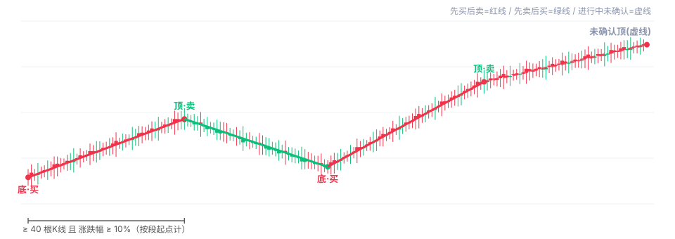
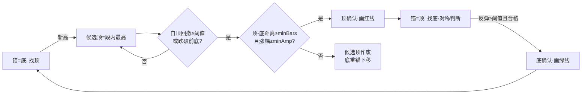
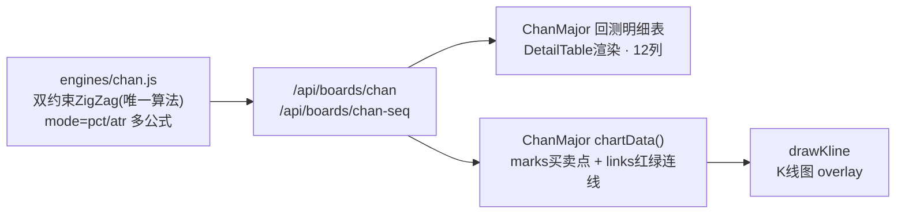

# oqt-quant-node — OKX 全市场涨跌家数量化看板 + 缠论大级别转折信号系统

> 纯 Node.js（零框架、原生 `node:http` + `node:sqlite`）实现的 OKX USDT 永续全市场监测与回测系统。
> **287 个合约**的涨跌家数秒级统计、两年历史回测、BTC 分时 K 线、**缠论大级别转折点买卖信号**（划线式确认 · 无预测）。

  

---

## 目录

- [系统架构](#系统架构)
- [核心功能明细](#核心功能明细)
- [缠论·大级别转折点信号（2026-10-28 新）](#缠论大级别转折点信号2026-10-28-新)
- [数据流水线与保鲜轮转](#数据流水线与保鲜轮转)
- [API 一览](#api-一览)
- [前端共享组件](#前端共享组件)
- [目录结构](#目录结构)
- [部署](#部署)
- [近期变更](#近期变更)

---

## 系统架构

```mermaid
graph TB
    subgraph OKX数据源
        WS[公共WS tickers<br/>wsfeed.js 250合约]
        WS2[私有/行情WS<br/>okxws.js]
        REST[REST K线<br/>okxgate.js 限流150ms]
    end

    subgraph 采集与存储
        KEEP[kline.js 保鲜轮转链<br/>30步加权 · tick 15s]
        KSTORE[(kline/{grain}/{inst}/{ym}.sqlite<br/>月分片 · 3m/5m/15m/1h/2h/4h)]
        AGG[updownstore.build<br/>增量+愈合窗口]
        UDB[(updown.sqlite<br/>预聚合涨跌家数<br/>grain,ts,up,down,flat,total)]
    end

    subgraph API层 server.js 零框架
        BOARDS["/api/boards/*<br/>updown / streak / chan / chan-seq"]
        SSE["/api/okx/updown-live (SSE)<br/>每秒推 当前bar+前一根"]
        LUD[liveupdown.js<br/>WS实时价 → 形成中bar]
        STATIC[静态资源 web/]
    end

    subgraph 前端 原生JS组件
        UP[UpDown 看板<br/>K线+悬浮窗+详细表格]
        DT[DetailTable<br/>唯一明细表组件]
        CM[ChanMajor<br/>缠论信号共享组件]
        ENG[ind-engine.js<br/>drawKline 图表引擎]
    end

    WS --> LUD --> SSE --> UP
    REST --> KEEP --> KSTORE
    KSTORE --> AGG --> UDB
    KSTORE --> BOARDS
    UDB --> BOARDS
    BOARDS --> UP
    BOARDS --> CM
    CM --> DT
    CM --> ENG
    UP --> ENG
```

---

## 核心功能明细

| 功能 | 说明 | 关键实现 |
|---|---|---|
| **全市场涨跌家数** | 287 个 USDT 永续每时间片上涨/下跌/平盘家数、比例、差额、最弱合约 | `updown.js` + `updown.sqlite` 预聚合（毫秒级查历史） |
| **BTC 分时 K 线** | 3m/5m/15m/1h/2h/4h， Canvas 自绘，MA/MACD/BOLL/通道/缠论线，缩放拖拽 | `ind-engine.js drawKline` |
| **悬浮窗统计** | 十字光标显示该时间全市场涨跌家数/比例/差额/BTC涨幅（**保留不变**） | `drawKline extraRows` |
| **详细表格** | 14 列 Excel 全框线（家数+BTC最高/最低/收盘/涨幅/振幅/最高幅度/涨跌幅/最低价跌幅），服务端分页每页 10 行 + «更早 跨窗口回溯 | `DetailTable` + `pageSlice` |
| **SSE 实时顶行** | 表格最顶 2 行秒级刷新：当前形成中 bar（WS 实时价）+ 前一根已收盘 bar；翻页/回溯自动停手 | `liveupdown.js` + `patchLiveTip` |
| **缠论大级别信号** | 见下节，回测表 + K线连线共用一个算法组件 | `engines/chan.js` + `ChanMajor` |
| **连续涨跌统计** | 连续 N 根涨/跌家数 > 100 的区段做多做空回测 | `streak.js` |
| **历史回补** | 全分时 K 线库回填 + 覆盖度看板 | `tools/backfill_deep.js` + `web/js/ui/backfill.js` |

---

## 缠论大级别转折点信号（2026-10-28 新）

> 需求原话：「用缠论写出大范围转折底部和顶部的买卖点……真正的大底部和大顶点才算，没有预测功能，是直接划线得来，底部和顶部连接最少 40-100 根 K 线的距离，并且连接在一起的涨跌幅在 10% 范围以上，底部是买，顶部是卖。」



### 规则（有别于常规缠论）

1. **双约束划线**：相邻底/顶两点必须**同时**满足
   - ① 间隔 ≥ `minBars` 根 K 线（默认 **40**，可调 40~100）
   - ② 连线涨跌幅 ≥ `minAmp` %（默认 **10%**，按段起点计）
2. **不满足就不画线** —— 中间的小顶小底一律无视，只有真正的大转折才连成折线；
3. **确认机制（无预测）**：候选顶需自高点回撤 ≥ 阈值（或跌破前底）才成立；候选底对称。全部由**已收盘 K 线**事后划线，绝无未来函数；
4. **重锚定**：价格突破未定型端点的极值时，端点顺延到新极值（旧候选只是途中波折）；
5. **连线配色（中国惯例）**：底→顶（先买后卖，涨）= **红线**；顶→底（先卖后买，跌）= **绿线**；进行中未确认段 = **虚线**。

### 算法流程



### 共享组件设计（一个算法，两处消费）



- **回测明细表**（12 列）：序号 / 时间 / 信号(底·买/顶·卖) / 转折价 / **涨家 / 跌家 / 上涨占比** / 距前信号(根) / 前段均涨占比 / 前段规律 / 到下一点涨跌幅 / 前段明细
- **前段逐根比例表**：每个信号可展开「与前一条连线之间」的**逐根 K 线**涨跌家数比例序列（顺序 / 时间 / 涨家 / 跌家 / 样本 / 上涨占比 / BTC 收盘），并给出前半段均值 vs 后半段均值 → 规律（前低后高(升) / 前高后低(降) / 平稳）
- **组件内多公式**：`pct` 固定阈值（默认）/ `atr` ATR 自适应（原理相同：阈值随波动放大自动抬高）
- **每个分时各自计算**，信号各不相同；仅 BTC

### 两年回测实测（2024-10-27 ~ 2026-10-28，minBars=40, minAmp=10%）

| 分时 | K线根数 | 信号数 | 买/卖 | 平均段 | 平均段幅 |
|---|---|---|---|---|---|
| 3m | 323,582 | 43 | 22/21 | 6,110 根 | 17.5% |
| 5m | 210,239 | 47 | 24/23 | 3,696 根 | 18.4% |
| 15m | 70,079 | 47 | 24/23 | 1,232 根 | 18.4% |
| 1h | 17,520 | 39 | 20/19 | 371 根 | 19.5% |
| 2h | 4,510 | 15 | 8/7 | 205 根 | 19.6% |
| 4h | 2,404 | 13 | 7/6 | 129 根 | 21.7% |

> 约束校验：全部相邻点对 **距离≥40根、涨段≥+10%、跌段≤-10%、交替出现，违规 = 0**。
> 典型样本：底部买点上涨占比 5.75%（涨15/跌246，市场普跌到底），顶部卖点 88.03%（涨228/跌31）。

---

## 数据流水线与保鲜轮转

```mermaid
graph LR
    A[OKX REST candles] -->|限流150ms| B[保鲜轮转链<br/>kline.js keepGrain]
    B -->|写| C[(月分片K线库)]
    C -->|updownstore.build<br/>增量BEAM=2000根| D[(updown.sqlite)]
    D -->|agg() 全量Map缓存60s| E[/api/boards/updown]
```

**保鲜轮转链**（2026-10-28 重写节奏）：tick **15s**（空闲 45s）、30 步加权序列 —— 3m×12 / 5m×12（各约 3 分钟追新一次）、15m×3（约 12 分钟）、1h/2h/4h 各×1（约 35 分钟）；实测 287 合约单轮约 56s。日志关键字 `分时保鲜·<grain>`。

**K线库**：`data/okx/kline/{grain}/{instId}/{YYYYMM}.sqlite`，表 `kline(ts,d,ym,o,h,l,c,v)`，只读 LRU 连接池（`kstore.js` 唯一入口）。

**预聚合库**：`data/okx/updown.sqlite`，表 `updown(grain,ts,up,down,flat,total[,min_pct,min_px,min_inst])`。低覆盖片（<5% 合约）不写入；构建增量窗口 2000 根用于愈合冻结空洞。

> ⚠️ **深历史修复**（2026-10-28）：5m 预聚合 2025-09 ~ 2026-07 曾存在低覆盖垃圾片（K线回补前写入），已通过**进程内全量重建**修复（独立进程无法写 server 持有的 WAL，须在服务进程内执行 `updownstore.build(grain,{full:true})`）。重建后 210,575 片全部满覆盖。

---

## API 一览

| 端点 | 说明 | 关键参数 |
|---|---|---|
| `GET /api/boards/updown` | 涨跌家数 + BTC K线 + 相关性 | `grain sector lead bars page pageSize beforeTs` |
| `GET /api/boards/chan` | **缠论大级别信号（两年）** | `grain days=730 minBars=40 minAmp=10 mode=pct/atr` |
| `GET /api/boards/chan-seq` | 单条连线区间逐根涨跌比例 | `grain ts minBars minAmp mode` |
| `GET /api/boards/streak` | 连续涨跌区段回测 | `grain thr minLen bars maxRows` |
| `GET /api/okx/updown-live` | **SSE** 当前bar+前一根（秒级） | `grain` |
| `GET /api/boards/buysignal` | (遗留) 旧版涨跌家数买卖信号 | `bars` — 已从 UI 下线 |
| `GET /` | 看板页面（零框架静态） | — |

响应示例（`/api/boards/chan`，节选）：

```json
{ "ok": true, "grain": "5m", "candles": 210239, "from": "2024-10-27", "to": "2026-10-28",
  "signals": [ { "ts": 1782868200000, "type": "B", "px": 57750.0,
    "up": 15, "down": 252, "total": 267, "upRatio": 5.62,
    "segBars": 4431, "segAmp": -14.17, "segAvgRatio": 45.22,
    "segFirst": 45.57, "segSecond": 44.86, "segTrend": "平稳",
    "nextAmp": null } ],
  "openLeg": { "fromTs": "...", "fromPx": 57750.0, "toTs": "...", "toPx": 87374.3, "amp": 51.3 },
  "stats": { "total": 47, "buy": 24, "sell": 23, "avgSegBars": 3695.8, "avgSegAmp": 18.35 } }
```

---

## 前端共享组件

| 组件 | 文件 | 职责 |
|---|---|---|
| `DetailTable` | `web/js/ui/detail-table.js` | **唯一明细表实现**：列配置驱动（cell/text/key + signCls）、client/server 双分页、tfoot 钩子、SSE 顶行 `tipFn+patchTip`（只换表体不闪信息行）、静态工具 esc/pct/td/pageBtns。详细表格 / 连续统计 / 缠论回测表 / 缠论分段表 四处共用 |
| `ChanMajor` | `web/js/ui/chan-major.js` | **缠论信号共享组件**：拉取并缓存 `/api/boards/chan`（60s）、组装 K线 `marks+links`（红绿连线/虚线开放段）、渲染回测表 + 参数选择器（40/60/80/100 根、pct/atr）、懒加载分段逐根比例表 |
| `UpDown` | `web/js/ui/updown.js` | 看板装配：K线区分时选项卡 + 表格区分时选项卡 + 缠论回测区 + 连续统计区，SSE 接入，定时轻刷新 |
| `drawKline` | `modules/okx/web/ind-engine.js` | Canvas 图表引擎：K线/均线/MACD/BOLL/缠论线/成交量/十字光标悬浮窗，**支持 `opts.links` 连线段**（2026-10-28 新增，视口裁剪+边缘外推）与 `opts.marks` 买卖点 |

---

## 目录结构

```
oqt-quant-node/
├── server.js                  # 零框架 HTTP 入口(静态+API+路由分发)
├── api/
│   ├── boards.js              # /api/boards/* 看板路由(updown/streak/chan/chan-seq…)
│   ├── market.js / okx.js / study.js
├── modules/okx/
│   ├── engines/
│   │   ├── kline.js           # K线拉取/保鲜轮转链(30步加权)
│   │   ├── kstore.js          # 月分片K线库唯一入口(LRU只读池)
│   │   ├── updown.js          # 涨跌家数计算+leadCandles
│   │   ├── updownstore.js     # 预聚合库(增量+愈合窗口)
│   │   ├── chan.js            # ★缠论大级别转折点引擎(唯一算法)
│   │   ├── liveupdown.js      # SSE 生产者(WS实时价→形成中bar)
│   │   ├── wsfeed.js / okxws.js / okxgate.js / streak.js / buysignal.js(遗留)
│   │   └── universe.js / rediscache.js
│   └── web/ind-engine.js      # Canvas图表引擎 drawKline(links/marks)
├── web/
│   ├── index.html
│   └── js/
│       ├── ui/                # DetailTable / ChanMajor / updown / backfill …
│       ├── chan-core.js / chan-draw.js / chan-signal.js  # 常规缠论绘制(DIF/DEA线)
│       └── net/ chart/ svc/
├── core/ lib/ service/        # guard心跳 / sqlite工具 / systemd辅助
├── tools/                     # 回补/验证/诊断脚本
├── docs/
│   ├── DEPLOY-NODE.md         # 部署手册
│   └── chan-zigzag.svg        # 缠论算法示意图
└── ARCHITECTURE.md
```

---

## 部署

```bash
# 服务器(dadi, Ubuntu): systemd 托管, 端口 80
sudo systemctl restart oqt-quant-node.service
sudo journalctl -u oqt-quant-node.service -f     # 观察保鲜/构建日志
```

- 运行身份 root，`PORT=80`；守护：`core/guard.js` 心跳 + `service/watchdog.js`
- 环境要求：Node ≥ 22（原生 WebSocket / node:sqlite）
- 详细步骤见 [docs/DEPLOY-NODE.md](docs/DEPLOY-NODE.md)

**开发约定**：改动后 `node --check` 语法校验 → 备份至 `.bak/` → scp 覆盖 → 重启 → curl 实测验证（日志/时间戳/真实数据，不猜）。

---

## 近期变更

### 2026-10-28
- **缠论大级别转折点信号上线**：`engines/chan.js` 双约束确认式 ZigZag（≥40根 & ≥10%，pct/atr 双公式，无预测）；`ChanMajor` 共享组件（回测表 + K线红绿连线 + 分段逐根比例表）；`drawKline` 新增 `links` 连线支持；删除旧「下跌占比≥50%×3→≤20%」BTC 信号表与 K线旧买点（`buysignal` 端点保留但 UI 下线）
- **唯一明细表组件**：`DetailTable` 统一四处表格（详细表格/连续统计/缠论回测/缠论分段），服务端分页 + SSE 顶行钩子
- **保鲜轮转链提速**：tick 100s/空闲跳过 → **15s 恒执行 + 30 步加权序列**；3m/5m 真实滞后从 12-35 分钟降到 3-8 分钟
- **SSE 顶行防撞修复**：`computePrev` 固定取 `cur.ts - GM`（根因：前收片与当前片撞同一时间戳造成「两个相同时间行」）
- **5m 预聚合深历史全量重建**：修复 2025-09 ~ 2026-07 低覆盖垃圾片（涨跌家数 total=1~19），重建后 210,575 片满覆盖
- **wsfeed 订阅竞态修复**：onopen 捕获具体连接+重试，250 合约 tickers 恢复稳定订阅

> **风险提示**：本项目为行情监测与历史回测工具，所有信号均为事后划线统计，不构成投资建议。
